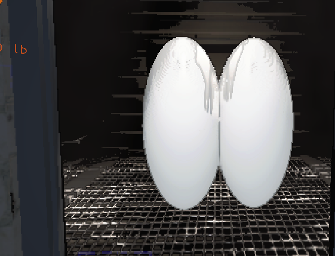
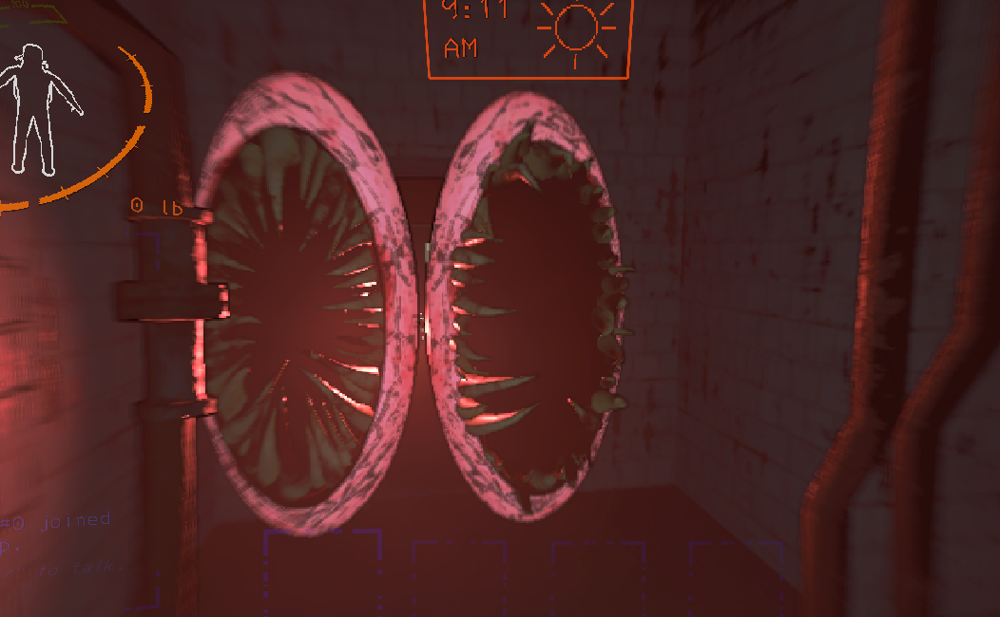
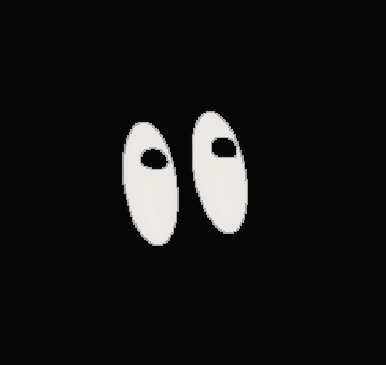

# Big Eyes

Add a new monster to the game. Don't look if he's awake...

Spoiler behavior

BigEyes have 3 phases :

First, he will sleep for 10 to 25 sec (default settings). While sleeping, he won't move and players can pass throught him.

Then, he wake up and walks around and search for player. 

if he sees a player he will scream and run towards the player. He will come back to search phase if he cannot see the player anymore

If he collides a player at any time while not asleep, he will kill him.

BigEyes return to sleep phase if he is **not** chasing a player after some time.

Add a new scrap item related to BigEyes

Spoiler scrap item

SmallEyes is simply the 'old' model of BigEyes.
You can use your mouse button to make some noise and play the old angry animations of BigEyes.

A lot of things is configurable, check them all ! (Speed, phases duration, scrap rarity... And a lot more)
Note that every player must have the same behavior configs, or this will cause desync issues.

For any issue or suggestion, feel free to open an issue on the GitHub project :)

## Credits

Many thanks to 
[QWERTYrodrigo](https://www.youtube.com/watch?v=eD1mFxvIL5w) - 
[Siphonife](https://www.artstation.com/siphonife) - 
[Solidstone](https://ko-fi.com/solidstonee)
who generously made the model of the monster and the animations, go check their works !

## Compatibility

- [SellMyScrap](https://thunderstore.io/c/lethal-company/p/Zehs/SellMyScrap/) - Add new BigEyes Scrap Eater 👀